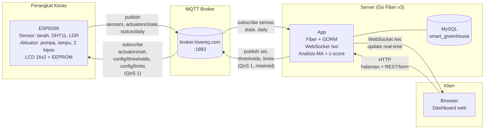

# SMART GREEN HOUSE MINI

## ANGGOTA KELOMPOK
- FEBRIAN THEOPILUS PURBA - H1H024011
- REFAN NUR CHANDRA - H1H024029
- HAMMED JASTIKO APURANAM - H1H024030

## Gambaran Umum

Proyek smart greenhouse mini berbasis IoT yang terdiri dari dua bagian utama:

1. **Perangkat keras (ESP8266)** — membaca sensor (kelembapan tanah, suhu/kelembapan udara, cahaya), mengendalikan aktuator (pompa air, grow light, kipas) melalui relay, dan menjalankan otomasi lokal. Kode ada di [`code/smartgreenhouse.ino`](code/smartgreenhouse.ino).
2. **Dashboard web (Go Fiber)** — menerima data sensor via MQTT, menyimpannya ke MySQL, menampilkan monitoring real-time (WebSocket), kontrol aktuator, aturan otomasi, riwayat, dan analisis data (moving average + deteksi anomali z-score). Kode ada di folder [`dashboard/`](dashboard/).

Komunikasi antara perangkat dan server berlangsung melalui broker MQTT publik (HiveMQ), sehingga keduanya tidak perlu berada di jaringan yang sama.

## Arsitektur



- **ESP8266 → Server**: data sensor, status aktuator, rekap harian (publish MQTT).
- **Server → ESP8266**: perintah ON/OFF aktuator, konfigurasi threshold & limits (publish MQTT, QoS 1).
- **Server → Browser**: halaman web + update real-time via WebSocket `/ws`.

## Teknologi

| Bagian | Teknologi |
|---|---|
| Perangkat | ESP8266, Arduino (ESP8266WiFi, PubSubClient, ArduinoJson, DHT, LiquidCrystal_I2C, EEPROM) |
| Backend | Go 1.27, Fiber v3, GORM + MySQL, paho.mqtt.golang, WebSocket |
| Frontend | Bootstrap 5.3, Chart.js 4.4, vanilla JavaScript |
| Infrastruktur | MQTT broker HiveMQ (publik), MySQL, NTP (UTC+7) |

## Struktur Folder

```
smart-greenhouse/
├── code/                  # Firmware ESP8266 (Arduino sketch)
│   └── smartgreenhouse.ino
├── dashboard/             # Aplikasi web Go Fiber
│   ├── main.go            # Entry point (listen APP_PORT, default 3000)
│   ├── bootstrap/         # Inisialisasi app, migrasi, seeder, middleware
│   ├── routes/            # Definisi route (web.go, api.go)
│   ├── app/
│   │   ├── http/controllers/  # Controller halaman & API
│   │   ├── http/middleware/   # Auth (session), CSRF, Guest
│   │   ├── models/            # Model GORM (7 tabel)
│   │   └── services/mqtt/     # Klien MQTT, subscriber, publisher, analisis
│   ├── database/          # Migrasi & seeder
│   ├── resources/views/   # Template HTML (Go template engine)
│   ├── public/            # Aset statis (css, js, img)
│   └── .env.example       # Contoh konfigurasi
├── documentation/         # Dokumentasi & foto perangkat
└── README.md
```

## Cara Menjalankan Dashboard

### Prasyarat

- Go 1.27+
- MySQL yang sudah berjalan, lalu buat database:
  ```sql
  CREATE DATABASE smart_greenhouse;
  ```

### Langkah

```bash
cd dashboard

# 1. Siapkan konfigurasi
copy .env.example .env        # Windows (PowerShell: Copy-Item .env.example .env)
# lalu edit .env: isi DB_PASSWORD dan MQTT_TOPIC_PREFIX (buat unik, lihat bagian MQTT)

# 2. Unduh dependensi
go mod download

# 3. Jalankan server
go run .
```

Server berjalan di `http://localhost:3000` (sesuai `APP_PORT`). Saat start, migrasi tabel dan seeder dijalankan otomatis:

- Login: `admin@greenhouse.test` / password: `password` (dari `ADMIN_EMAIL` / `ADMIN_PASSWORD` di `.env`)
- 3 aktuator dibuat otomatis: `pump`, `fan`, `light`

### Build produksi

```bash
go build -o smart-greenhouse .
./smart-greenhouse
```

Log aplikasi ditulis ke stdout dan `storage/logs/app.log`.

## Perangkat Keras (ESP8266)

### Komponen & Pin

| Komponen | Pin | Keterangan |
|---|---|---|
| Sensor kelembapan tanah | A0 (analog), D8 (power) | Kalibrasi ADC: kering 1023, basah 467; power hanya ON saat baca |
| DHT11 (suhu & kelembapan udara) | D3 | |
| LDR (cahaya, digital) | D0 | Terang = LOW |
| Relay pompa air | D5 | Aktif LOW |
| Relay grow light | D4 | Aktif LOW |
| Relay kipas 1 | D7 | Aktif LOW |
| Relay kipas 2 (kaskade) | D6 | Aktif LOW |
| LCD 16x2 I2C (alamat 0x27) | D2 (SDA), D1 (SCL) | |

### Otomasi di Perangkat

- **Pompa**: menyala saat kelembapan tanah < 30%, berhenti di > 45%. Dosis siram 5 detik, jeda antar siram 30 detik, batas maksimum 6x/hari.
- **Kipas 1**: menyala saat suhu > 32°C, mati di < 30°C. **Kipas 2** menyala jika suhu belum turun ≥ 1°C setelah 30 detik.
- **Grow light**: mengikuti LDR (dengan debounce 10 detik) pada jendela jam 06:00–22:00 WIB, mencapai target durasi cahaya harian (default 16 jam).
- Saat menerima perintah manual dari server, threshold lokal aktuator terkait dinonaktifkan sementara agar tidak bentrok.
- Data rekap harian disimpan ke EEPROM sebagai cadangan saat offline; otomasi lokal tetap berjalan meskipun MQTT/WiFi terputus.

### Sebelum Flashing

Isi `WIFI_SSID` (baris 10 `code/smartgreenhouse.ino`) dengan nama WiFi Anda. Pastikan `MQTT_PREFIX` sama dengan `MQTT_TOPIC_PREFIX` di `.env` dashboard.

## Topik MQTT

Prefix topik diambil dari `MQTT_TOPIC_PREFIX` (contoh di `.env.example`: `smartgreenhouse/kelompok678pemancinghandal123`). Ganti dengan prefix unik milik Anda karena broker HiveMQ bersifat publik.

### ESP8266 → Server

| Topik | Payload | Keterangan |
|---|---|---|
| `<prefix>/sensors` | `{"temperature":28.5,"humidity":70.2,"soil":45,"light":600}` | Dikirim tiap 5 detik |
| `<prefix>/actuators/<kode>/state` | `ON` atau `OFF` | `<kode>`: `pump`, `fan`, `light`; dikirim saat status berubah & saat reconnect |
| `<prefix>/status/daily` | `{"light_seconds":3600,"water_count":2}` | Rekap harian; tiap 30 detik & setelah siram |

### Server → ESP8266

| Topik | Payload | Keterangan |
|---|---|---|
| `<prefix>/actuators/<kode>/set` | `ON` atau `OFF` | Perintah kontrol dari dashboard |
| `<prefix>/config/thresholds` | `{"pump":{"active":true,"on_value":30,"off_value":45},"fan":{...},"light":{...}}` | Aturan otomasi; QoS 1, retained |
| `<prefix>/config/limits` | `{"light_target_hours":16,"max_watering_per_day":6}` | Batas harian; QoS 1, retained |

Konfigurasi thresholds/limits dipublish ulang otomatis setiap kali server tersambung ke broker atau pengaturan diubah dari dashboard.

## Fitur Dashboard

| Halaman | URL | Fitur |
|---|---|---|
| Login | `/login` | Autentikasi session (cookie HttpOnly, idle 2 jam) |
| Dashboard | `/` | Kartu sensor live (WebSocket), indikator moving average & anomali z-score, progres cahaya & penyiraman harian, form batas harian, grafik live, switch aktuator, ringkasan MIN/AVG/MAX 24 jam |
| Monitoring | `/monitoring` | 4 grafik per sensor + garis moving average + titik anomali merah, rentang 30/60/120/300 data |
| Kontrol Aktuator | `/actuators` | Switch ON/OFF (terkunci saat mode auto), tombol Manual/Otomatis, 10 log terbaru |
| Otomasi | `/automation` | Tambah/toggle/hapus aturan threshold dengan histeresis (batas nyala & mati) |
| Riwayat | `/history` | Tab Data Sensor, Log Aktuator (dengan sumber manual/auto/device), Cahaya & Penyiraman harian; pagination 20/halaman |

### Analisis Data (Moving Average & Anomali)

- **Moving average** dan **z-score** dihitung real-time untuk setiap pembacaan sensor sebelum disiarkan ke browser.
- Titik dengan `|z| >= threshold` ditandai sebagai **anomali** (titik merah pada grafik).
- Parameter diatur via `.env`: `MA_WINDOW` (default 5), `ZSCORE_WINDOW` (default 30), `ZSCORE_THRESHOLD` (default 3).
- Endpoint `/api/sensors/history` menghitung ulang MA/z-score/anomali untuk data historis.

## API Endpoint

Semua endpoint `/api/*` memerlukan **login (session cookie)**. Jika belum login, dijawab `401` dengan `{"message":"Silakan login terlebih dahulu"}`.

| Method | Path | Keterangan |
|---|---|---|
| GET | `/api/sensors/latest` | Pembacaan sensor terakhir |
| GET | `/api/sensors/history?limit=N` | Riwayat sensor (limit 1–500), sudah dihitung ulang MA + z-score per titik |
| GET | `/api/status` | Status koneksi MQTT + daftar aktuator |
| GET | `/api/greenhouse/limits` | Batas harian: `{"data":{"light_target_hours":16,"max_watering_per_day":6}}` |
| GET | `/api/greenhouse/daily` | Progres harian: `{"data":{"light_seconds":0,"water_count":0}}` |

Catatan: `light_seconds` dan `water_count` pada `/api/greenhouse/daily` berada di memori server — nilainya `0` jika ESP8266 belum mengirim `status/daily` sejak server berjalan.

### Cara Menguji `/api/greenhouse/daily`

Karena endpoint dilindungi session, request harus membawa cookie login. Contoh:

**PowerShell** (login dulu, simpan session):
```powershell
$sess = $null
Invoke-WebRequest -Uri "http://localhost:3000/login" -Method Post `
  -Body @{email="admin@greenhouse.test"; password="password"} `
  -SessionVariable sess | Out-Null
(Invoke-WebRequest -Uri "http://localhost:3000/api/greenhouse/daily" -WebSession $sess).Content
```

**curl** (cookie jar):
```bash
curl -c cookie.txt -d "email=admin@greenhouse.test&password=password" http://localhost:3000/login
curl -b cookie.txt http://localhost:3000/api/greenhouse/daily
```

**Browser**: login dulu di `http://localhost:3000/login`, lalu buka URL API di tab yang sama. Bisa juga lewat DevTools → tab Network saat dashboard terbuka.

## Konfigurasi `.env`

| Variabel | Default | Keterangan |
|---|---|---|
| `APP_PORT` | `3000` | Port server |
| `APP_TIMEZONE` | `Asia/Jakarta` | Zona waktu aplikasi |
| `DB_HOST` / `DB_PORT` / `DB_DATABASE` / `DB_USERNAME` / `DB_PASSWORD` | `127.0.0.1` / `3306` / `smart_greenhouse` / `root` / *(kosong)* | Koneksi MySQL |
| `MQTT_BROKER` | `tcp://broker.hivemq.com:1883` | Alamat broker MQTT |
| `MQTT_TOPIC_PREFIX` | — | Prefix topik; **wajib unik** (broker publik), harus sama dengan `MQTT_PREFIX` di `.ino` |
| `SENSOR_SAVE_INTERVAL` | `10` | Interval minimal (detik) penyimpanan data sensor ke database |
| `MA_WINDOW` | `5` | Jendela moving average |
| `ZSCORE_WINDOW` | `30` | Jendela z-score |
| `ZSCORE_THRESHOLD` | `3` | Ambang anomali (`|z| >= threshold`) |

## Catatan

- View `resources/views/greenhouse/limits.html` yang dirender oleh `GET /greenhouse/limits` belum ada di repo; fitur pengaturan batas harian tetap berfungsi melalui form di halaman Dashboard.
- Beberapa komentar di kode server menulis "ESP32" — perangkat yang digunakan sebenarnya **ESP8266**.
